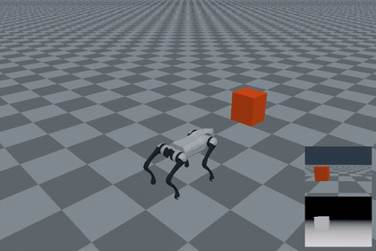
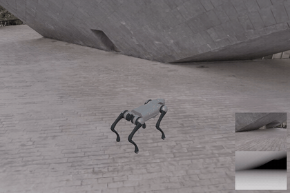

# Sire CUDA

Sire 是一个刚体动力学仿真器。本分支提供 CUDA 批量仿真、Go2 强化学习入口、单场景 Viewer 和批量 RGB-D 相机。

## CUDA 后端与强化学习

CUDA 后端支持 Go2 平地任务，物理步进、观测、奖励和 PPO 更新可以在同一块 GPU 上运行。在 Linux 上准备 CUDA Toolkit 12.4 或更新版本、CUDA 版 PyTorch 和仓库锁定的原生依赖。以下示例使用 RTX 40 系列的计算能力 `89`。[原生依赖和构建步骤](docs/cuda_implementation.md#linux-构建)

```bash
SIRE_ENABLE_CUDA=ON CMAKE_CUDA_ARCHITECTURES=89 \
  python -m pip install -e './python[viewer]'

python demo/demo_python/SireRLGym/scripts/train.py --task go2 --flat_terrain \
  --sire_backend cuda --rl_device cuda:0 --num_envs 256 --max_iterations 3
```

训练入口为 [`train.py`](demo/demo_python/SireRLGym/scripts/train.py)。`--num_envs` 设置并行环境数，`--sire_cuda_streams` 默认是 4，`--save_interval` 设置 checkpoint 间隔。另有 1024 环境长跑配置和步进基准。[完整参数与示例](docs/cuda_implementation.md#训练与步进基准)

## 场景渲染与相机

Go2 示例入口为 [`sim2sim/walk_sire.py`](sim2sim/walk_sire.py)。三种模式共用 Sire 刚体求解和同一套策略。运行前准备 Go2 的 TorchScript 策略及可视网格。[SDK 安装](python/BUILDING.md) · [策略导出和 Go2 资产](sim2sim/README.md#sire-单场景实时行走与-rgb-d)

| 操作 | 参数 |
| --- | --- |
| 仅仿真和策略推理 | `--render-mode none` |
| 窗口可视化与 RGB-D 预览 | `--render-mode classic`（默认）或 `--render-mode photoreal` |
| 无窗口离屏采集 | 在渲染模式下加 `--headless`，用 `--save-rgbd` 导出最后一帧 |

```bash
sire_policy=/path/to/go2_jit.pt
sire_meshes=/path/to/mujoco_menagerie/unitree_go2/assets

python -m sim2sim.walk_sire --policy "$sire_policy" --render-mode none --duration 4

python -m sim2sim.walk_sire --policy "$sire_policy" --mesh-dir "$sire_meshes" \
  --render-mode classic --duration 4

python -m sim2sim.walk_sire --policy "$sire_policy" --mesh-dir "$sire_meshes" \
  --render-mode classic --headless --camera-size 320 240 \
  --duration 4 --save-rgbd frame.npz
```

`CameraConfig` 配置内参、分辨率、频率、裁剪距离和刚体安装位姿。单相机使用 `Camera.read()` 读取 RGB-D。离屏 `BatchCamera.capture(poses)` 接受 CUDA 刚体位姿张量，返回 CUDA RGB、米制光轴深度和有效掩码。[Python API 参考](docs/api_reference.md)

## 经典渲染、3DGS 与 Real2Sim

| 经典 GLFW Viewer | 3DGS Viewer |
| --- | --- |
| [](docs/media/sire-viewer-classic.webm) | [](docs/media/sire-viewer-3dgs.webm) |
| [视频 WebM](docs/media/sire-viewer-classic.webm) | [视频 WebM](docs/media/sire-viewer-3dgs.webm) |

3DGS 演示使用 Xia 等人发布的 Habitat-GS `scene56` 资产（Apache-2.0）。[Habitat-GS 数据集](https://huggingface.co/datasets/RukawaY/gs_scenes)

3D Gaussian Splatting（3DGS）用三维高斯描述实拍环境的外观，相机移动时由 GPU 渲染新的视角。Sire 的场景 JSON 对齐高斯外观、相机深度网格和碰撞网格。下面的示例使用 CUDA 生成 RGB，并使用 Sire CPU 后端与扫描场景接触。[安装真实感依赖](python/BUILDING.md#真实感渲染依赖) · [Scene56 资产与配置](sim2sim/README.md#真实感模式)

```bash
python -m sim2sim.walk_sire --policy "$sire_policy" --mesh-dir "$sire_meshes" \
  --render-mode photoreal --scene /path/to/room.json --cmd 0.10 0 0 --duration 4
```

Real2Sim 支持导入 GS-Real2Sim 的 OBJ 和高斯 PLY，也可以用实测且已标定的 RGB-D 融合出米制网格。离线工具入口为 `python -m sire.scene_import`。批量相机支持静态 3DGS 合成，当前 CUDA 训练示例使用 Go2 平地接触和状态观测。[场景导入 API](docs/api_reference.md) · [GS-Real2Sim](https://github.com/discoverse-dev/gs-real2sim)

## 论文与许可证

Sire 的高刚度连续接触方法发表于 IEEE Robotics and Automation Letters。[A Convergent Continuous Contact Solver With Explicit Separation Time for High-Stiffness Contact](https://doi.org/10.1109/LRA.2026.3692328)

本项目采用 [MIT 许可证](LICENSE.txt)。
